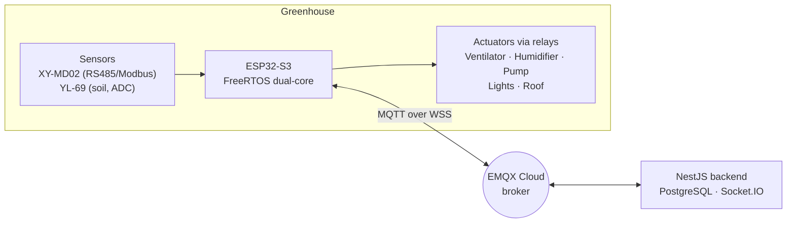

# 🌱 Smart Farm Automation System

**A smart greenhouse controller that keeps working when the network doesn't.**

Built during an internship at **FEED IN GREEN**, this IoT system combines an **ESP32-S3** controller (sensors + actuators) with a **NestJS** cloud backend, connected through **MQTT over secure WebSocket (WSS)**.


---

## Why this project

Managing a greenhouse by hand means frequent on-site checks, late reactions to temperature or humidity changes, and water and energy used without measurements.

This system automates a simple loop, **measure → decide → act**, and makes it available remotely. It aims to:

- ⚡ **Optimize energy use** by running ventilation and humidification only when needed
- 💧💰 **Reduce water and operating costs** by irrigating from real soil data
- 🌾 **Support better production** by keeping temperature, humidity and soil moisture in target ranges

Because Wi-Fi and cloud links do fail on farms, one rule drives the design:

> **If the cloud goes away, the greenhouse must still be controlled.**

---

## Highlights

- 🧠 **Dual-core FreeRTOS firmware:** networking on Core 0, sensing and control on Core 1, so slow reconnects never block the relays
- 🛟 **Local backup mode:** after 30 s without MQTT, the ESP32 controls the greenhouse by itself
- 🔌 **Reliable sensing:** RS485/Modbus and ADC readings are validated and retried; invalid data is never used
- 🔐 **Traceable commands:** each command has an `actionId`, duplicates are ignored, and every action is acknowledged
- ☁️ **Full cloud path:** EMQX broker → NestJS → PostgreSQL, with live updates via Socket.IO
- 🛡️ **Secured backend:** JWT in HttpOnly cookies, Helmet, CSRF protection, rate limiting

---

## Architecture



Telemetry goes up (sensors → broker → backend), commands come down (backend → broker → relays), and a local path (sensors → ESP32 → relays) works without the cloud.

---

## Local backup mode

When MQTT is unavailable for more than 30 s, the ESP32 applies these rules on its own. When the connection returns, all relays reset to OFF and remote control resumes.


---

## Tech stack

| Layer | Technology |
|-------|-----------|
| Firmware | ESP32-S3, Arduino core, FreeRTOS, PubSubClient, WebSockets |
| Sensors | XY-MD02 (temperature, humidity), YL-69 (soil moisture) |
| Actuators | 8-relay board: ventilator, humidifier, water pump, lights, roof |
| Backend | NestJS v11, TypeORM, PostgreSQL, JWT, Socket.IO |
| Broker | EMQX Cloud (MQTT over WSS, port 8084) |

---

## Repository structure

```
├── docs/        architecture, MQTT topics, setup guides, DB schema
├── firmware/    ESP32-S3 firmware + secrets.h.example
└── backend/     NestJS application (smart-farm-backend)
```

---

## Quick start

**Prerequisites:** Node.js ≥ 22, PostgreSQL ≥ 14, an EMQX Cloud account (free tier is enough), Arduino IDE ≥ 2.x with ESP32-S3 support.

**Backend**

```bash
cd backend/smart-farm-backend
cp .env.example .env          # fill in your credentials
npm install
npm run start:dev
```

**Firmware**

1. Copy `firmware/secrets.h.example` to `firmware/secrets.h` and fill in your Wi-Fi and MQTT credentials
2. Install the libraries listed in [`firmware/README.md`](firmware/README.md)
3. Flash to your ESP32-S3

> ⚠️ **Never commit `.env` or `secrets.h`.** Both are gitignored.

More details: [`docs/`](docs/) · MQTT topics: [`docs/MQTT_topics.md`](docs/MQTT_topics.md)

---

## Security note

Credentials live only in `.env` and `secrets.h`, and MQTT runs over WSS (TLS). In the tested firmware build, broker certificate verification is off, so the link is encrypted but the broker is not authenticated; enabling it is planned.

---

## Roadmap

- [ ] Calibrate the soil sensor for real soil
- [ ] Add a light sensor (BH1750)
- [ ] Enable broker certificate verification
- [ ] Long-term tests in real farm conditions
- [ ] Add more sensors, history analysis and fault diagnostics

> Energy, cost and production benefits are **design goals**. No gain is claimed without measured field results.

---

## Author

**Nour Ben Ibrahim**, internship at **FEED IN GREEN** (2025–2026).

## License

Contact the author before reuse. A license file will be added before the first stable release.